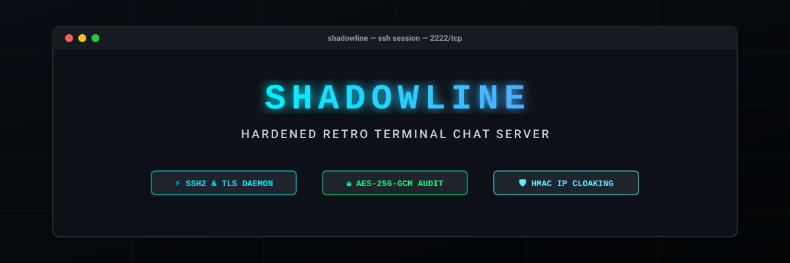

# ShadowLine ⚡

<p align="center">
  
</p>

<p align="center">
  <strong>A hardened, retro-inspired terminal chat server with SSH2, TLS, and AES-256-GCM audit logging.</strong>
</p>

<p align="center">
  <a href="LICENSE"></a>
  
  
  
  
</p>

<p align="center">
  <a href="#-tech-stack">Tech Stack</a> •
  <a href="#-key-features">Key Features</a> •
  <a href="#-quick-start">Quick Start</a> •
  <a href="#-client-connections">Client Connections</a> •
  <a href="#-commands-cheat-sheet">Commands</a> •
  <a href="#-security-architecture">Security</a> •
  <a href="#-license">License</a>
</p>

---

## 🛠️ Built With

<p align="center">
  
  
  
  
  
  
</p>

---

## ⚡ Key Features

- **Zero-Install SSH Access:** Connect directly from any standard terminal with `ssh username@host -p 2222`. No desktop client or special package required.
- **Cryptographic Public Key Authentication:** Enforce registered nicknames using OpenSSH public keys (`keys/chat-users.json`). Rejects unsigned, unauthenticated, or impersonated logins.
- **Session-Bound Private Messaging (`/reply`, `/r`):** Messages are delivered to immutable UUID session identifiers. Changing a nickname does not break replies, and disconnecting prevents hijacked delivery.
- **Dedicated TLS Client Protocol (Port 6697):** Encrypted alternative transport channel with socket-level DDoS rate limiting and 15-second handshake timeouts.
- **Channel Moderation & Permission Isolation:**
  - Password-protected channels (`/key <password>`).
  - Strict membership check: unauthorized users cannot broadcast or view member lists (`/who`).
  - Channel topic (`/topic`), user kick (`/kick`), action messages (`/me`), and auto-responder (`/away`).
- **HMAC-SHA256 IP Masking:** Real user IP addresses are never exposed to other connected peers; each user gets a deterministic masked host like `~nick@23c784da.whononymous.onion`.
- **Server Owner Encrypted Audit Trails:** Full forensic event logs encrypted on disk with AES-256-GCM using `MASTER_LOG_KEY`.
- **Interactive Terminal UX:** Tab auto-completion for commands and nicknames, ANSI color palettes, and terminal bell (`\x07`) pings on mentions.

---

## 🚀 Quick Start

### 1. Clone & Install
```bash
git clone https://github.com/kayradivrik/ShadowLine.git
cd ShadowLine
npm install
```

### 2. Configure Environment
```bash
cp .env.example .env
```
Generate an authorized user in `keys/chat-users.json`:
```json
{
  "samsepi0l": "ssh-rsa AAAAB3NzaC1yc2EAAAADAQABAAACAQ..."
}
```

### 3. Start the Server
```bash
npm start
```

---

## 💻 Client Connections

### Option A: Standard SSH (Zero Setup)
```bash
ssh -i ~/.ssh/id_rsa samsepi0l@127.0.0.1 -p 2222
```

### Option B: Custom TLS Client
```bash
npm run client -- guest_user 127.0.0.1 6697
```

---

## 📜 Commands Cheat Sheet

| Command | Usage | Description |
| :--- | :--- | :--- |
| `/join` | `/join <#channel> [password]` | Join or create a channel |
| `/msg` | `/msg <nick> <message>` | Send a direct encrypted message (triggers ping bell) |
| `/reply` | `/reply <message>` | Respond to last DM peer via immutable session UUID |
| `/nick` | `/nick <new_name>` | Update your display nickname |
| `/me` | `/me <action>` | Broadcast third-person action (`* nick drinks coffee`) |
| `/topic` | `/topic [new_topic]` | View or update channel topic (channel admin only) |
| `/kick` | `/kick <nick> [reason]` | Remove user from room to lobby (channel admin only) |
| `/away` | `/away [message]` | Toggle automated away responder |
| `/key` | `/key [password]` | Lock/unlock room password (`+k`) |
| `/secret` | `/secret` | Toggle room visibility in `/list` (`+s`) |
| `/who` | `/who` | Display verified members of current channel |
| `/list` | `/list` | List public non-secret channels |
| `/clear` | `/clear` | Clear terminal window buffer |
| `/quit` | `/quit` | Terminate session cleanly |

---

## 🔒 Security Architecture

```
                      +-----------------------------+
                      |         ShadowLine          |
                      +--------------+--------------+
                                     |
               +---------------------+---------------------+
               |                                           |
         [Port 2222]                                 [Port 6697]
          SSH2 Daemon                                 TLS Stream
     OpenSSH Public Key                          Socket Rate Limiter
     Interactive PTY Shell                       JSON Stream Handshake
               |                                           |
               +---------------------+---------------------+
                                     |
                      +--------------+--------------+
                      |   Core Hardening Engine     |
                      +--------------+--------------+
                      | - UUID Immutable Sessions   |
                      | - Room Permission Guard     |
                      | - HMAC-SHA256 IP Cloaking   |
                      | - AES-256-GCM Audit Logger  |
                      +--------------+--------------+
                                     |
                          [logs/audit.enc.log]
```

### Forensic Audit Log Inspection (Server Owner Only)
```bash
# Decrypt all audit entries
npm run logs

# Stream real-time events
npm run logs -- --live

# Filter by nickname or masked host
npm run logs -- samsepi0l
```

---

## 🧪 Security Test Suite

Run the 11-step automated security validation suite:
```bash
npm test
```
Verifies:
- Session ID persistence across nickname changes
- Delivery termination on disconnect (no cross-session leaks)
- Public key signature validation & rejection of unsigned SSH logins
- TLS client rejection of reserved / registered nicknames
- Default room password enforcement & `/who` isolation
- AES-256-GCM ciphertext integrity and scrypt key derivation

---

## 🏷️ GitHub Topics & SEO
Recommended topics for repository discovery:
`terminal-chat` • `ssh-server` • `ssh2` • `tls-client` • `cli-chat` • `retro-terminal` • `aes-256-gcm` • `cybersecurity` • `nodejs` • `linux-daemon` • `secure-messaging` • `audit-logging`

---

## 📄 License

This project is licensed under the [MIT License](LICENSE) — Copyright (c) 2026 Kayra Divrik.
